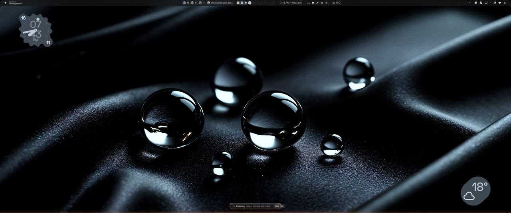
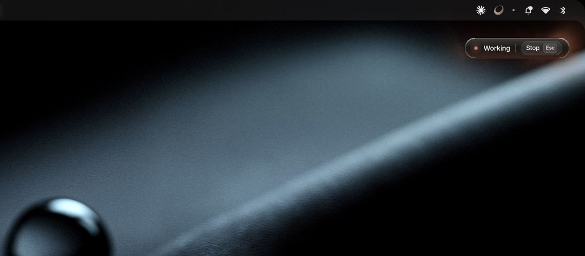

# SudoClaude

Computer use for Linux. It lets Claude see the screen, move its own cursor, type, open apps and actually work inside them, like the computer use Claude already has on macOS and Windows. I built it on my own setup (Garuda with Hyprland and the end-4 dots), so that's where it's tested. Other Arch-based distros running Hyprland should be fine, and it picks up your own rounding, colors and keybinds instead of mine.

It runs as a local MCP server, so the Claude desktop app and Claude Code can both use it.


<sub>The overlay's own QML rendered frame by frame over my desktop: listening, working on screen, working on the workspace to the right, then the corner pill it switches to when you're in a game.</sub>

| Listening (rendered) | While you're gaming | Claude's cursor |
|---|---|---|
|  |  |  |

## Install

You need an Arch-based distro, Hyprland, and Claude Code (or the Claude desktop app). Quickshell is needed for the overlay; the end-4 dots already come with it.

```sh
git clone https://github.com/splitshotz/SudoClaude ~/Projects/SudoClaude
cd ~/Projects/SudoClaude
./install.sh
```

The script installs what's missing with pacman, registers the server with Claude Code (`claude mcp add`) and the desktop app (it backs up that config first), and runs a quick self-test. It then asks whether you want the Chromium extension and the voice assistant. If you use the desktop app, quit it from the tray and open it again so it loads the server. In Claude Code it's there in your next session; try asking it to open an app and do something in it.

Nothing in your Hyprland config changes except one thing: if you set up voice, it adds two binds to your user keybinds file (end-4's `custom/keybinds.lua` or `.conf`), Super+Space to talk and Super+Shift+Escape to stop. It checks they're free first and backs the file up. If they're taken, pick your own with `bin/sudoclaude-keybind SUPER+ALT+C SUPER+ALT+X`.

## What it can do

Anything you'd do with a mouse and keyboard. That includes every kind of click, click and hold, pressing and releasing any mouse button, drags, smooth paths through several points, relative mouse movement for games, scrolling in any direction, typing any unicode, any key combo (raw keycodes too), and holding keys down across other actions, like holding W while moving the mouse.

There are seven tools:

- `computer` covers the screen, mouse and keyboard. It uses the same action names as Claude's own computer use, and it takes a whole list of actions at once, so Claude can plan a sequence of moves and run it in one go instead of checking after every step.
- `open_application` opens anything with a .desktop entry by name, or focuses it if it's already running, and waits for the window.
- `desktop` handles Hyprland: workspaces (special ones too), windows, monitors, launching commands, the clipboard, and your keybinds with the same labels the Super+/ cheatsheet shows. Those come from the live config, so if you change a bind it picks that up.
- `ui` reads an app's real interface through AT-SPI (buttons, fields, menus, tabs with their labels and positions) and can press, fill in or toggle things without touching the mouse. Its `see` action is how Claude usually looks at an app: one capture of that window, even if it's behind something or on another workspace, with every control boxed and numbered, like the macOS and Windows versions of computer use. When an app draws its own UI and exposes nothing, the numbers come from OCR'd text instead. GTK, Qt, Firefox-based browsers like Zen, and Electron apps all work this way, so it isn't tied to one browser.
- `browser` uses Chromium tabs directly through the extension (see Browser below).
- `music` controls Apple Music in Cider without touching its window.
- `access` is for the few sensitive apps that need a yes from you first.

Screenshots can also grab a single window, even one on another workspace or under other windows, and shortcuts can go to a window in the background.

Clicking through an app is the fallback, though. Claude is told to use whatever is best for each step: an MCP server or skill made for the app (Unity, Blender, Figma and so on), a command line tool, an API, or just editing the files, and to reach for the screen only when nothing better exists or it needs to see how something actually looks.

## Browser

For websites, Claude doesn't have to look at pixels and move your mouse. A small Chromium extension lets it read a page's buttons, links and fields, click and type into them by reference, and screenshot the tab itself, the same way Claude in Chrome works. It does this through Chrome's debugger API, so it works in a background tab while you use the mouse for something else. While it's working, Chromium shows its usual "is debugging this browser" bar; it goes away about 20 seconds after Claude stops.

`./install.sh` sets it up (or run `bin/sudoclaude-browser-setup`), then restart Chromium once. The extension only talks to SudoClaude on this computer, over a local socket that needs a token only your user can read.

## Keeping usage down

Screenshots are what eat into usage, so Claude only looks at what it needs. It can screenshot just a region or one window, and it can switch its view to the focused window or a fixed area so every check after that only covers that part. A dialog-sized region costs around 200 tokens, while the whole ultrawide is roughly 500, 900 or 1,400 depending on the detail level. It can switch back to the full screen whenever it needs the bigger picture. After an action Claude can ask for a `diff` instead of an image, which is a line of text saying whether the screen changed and where, and then zoom into just that part if it needs to. The accessibility tree and window lists are plain text and usually cheaper than looking. The tool definitions themselves come to about 1,700 tokens.

## How it works

Input goes through the Wayland virtual pointer and virtual keyboard protocols over one socket the server keeps open, which means no ydotool, no root and no extra daemon, and each action takes well under a millisecond. Screenshots come from wlr-screencopy in the same process (about 10 ms) and get scaled to a size Claude reads well. A 3440x1440 monitor comes out at 1568x656. Coordinates map back exactly, HiDPI and mixed scaling included. Window captures use Hyprland's toplevel export, and windows, workspaces and binds come from the Hyprland IPC socket.

## Permissions

Ask it to do something and it does it. Opening apps, clicking around, typing in a terminal and switching workspaces all happen without a confirmation dialog.

It only stops to ask for things that are actually sensitive: password managers, software installers and package managers, disk and partition tools, system settings, and reading the clipboard (which tends to have passwords in it). You get one dialog with allow for this session, always allow, or deny, and windows from those apps stay blacked out in Claude's screenshots until you allow them. Claude can never control itself, its own approval dialogs or polkit prompts.

If you want the stricter rules Claude uses on macOS (browsers view only, terminals and IDEs click only, a dialog for every new app), set `"approvals": "strict"`.

Only one Claude session can drive the desktop at a time.

To stop it, press Esc or click Stop on the pill at the bottom of the screen. The Esc part is a temporary bind that only exists while Claude is working. It doesn't swallow the key and it doesn't change any of your own binds.

## Working next to you

You can keep using the computer while Claude works. When you're active, apps it opens land on your workspace on the side away from your cursor and don't take focus. Keys it sends go to its own window in the background, so your typing never ends up in its window or the other way round. When it really needs the mouse, it waits until your hand stops moving, clicks, then puts the pointer back where you left it and gives focus back to your window.

If you're in a fullscreen game or watching a video, it leaves your workspace alone and works on a free one instead.

## The overlay

While Claude is working, a thin orange line runs along the edge of the screen with a short bright streak slowly travelling around it. Claude also gets a small cursor of its own with a "Claude" tag, and a glass pill says what it's doing. Where the line shows depends on what Claude is doing:

- working on your screen: the line goes around the whole screen
- working in a window next to yours: it traces just that window
- working on the workspace to your left or right: only that edge lights up
- you're gaming or watching something fullscreen: only a small pill in the top right corner

There are a few other looks if the line isn't your thing. Set `"overlay_style"` in the config to `hairline` (the default), `brackets` (viewfinder corners), `spotlight` (a warm glow under the pill, nothing on the edges), `minimal` (just the pill and cursor) or `glow` (a soft glow on the edges). Previews are in [docs/options](docs/options).

The pill sits at the bottom by default. Drag it anywhere, or just flick it toward an edge or corner and it carries on to the nearest of eight spots (the four edges and four corners) and stays there next time. It's glass: Hyprland blurs whatever is behind it, and the rim bends the content just past its edge like a lens, with a glint that slides round while you move it. The colors come from your end-4 Material You palette when you have one.

It runs on Quickshell as its own layer and your mouse goes straight through everything except the pill. It shows up in your own screenshots and recordings like any other part of the screen; Claude's screenshots hide it for a frame so it doesn't get in Claude's way. The blur comes from layer rules the server adds at runtime, so nothing in your config changes.

## Voice

Say "Claude" and talk. It's a separate service that's off until you set it up:

```sh
./install-voice.sh
```

That makes a Python 3.11 environment, downloads the models, adds an echo cancelled mic input to PipeWire (so it can hear you over music and over itself), trains the wake word, and starts a user service. The replies go through Claude Code, so it uses your normal Claude login and plan. If `claude` isn't logged in, run `claude` and then `/login` once.

How it behaves:

- "Claude, open Discord" works in one breath, or say "Claude", wait for the chime, then talk.
- Super+Space does the same without the wake word. Press it again to end your turn, or while Claude is talking to cut in.
- While it's listening, double tap Space and the pill turns into a text box so you can type instead. Enter sends, Escape cancels. This is off when a fullscreen app or game has focus.
- After it answers, the mic stays open for a few seconds so you can follow up without saying its name again. If what it hears clearly isn't meant for it, it ignores it.
- Saying "Claude" while it's talking or working interrupts it. Talking over it softens its voice first and only cuts it off if you're actually saying something.
- Music and videos get turned down while you're talking to it and come back up after.
- It leaves on its own when you're done, or when you say something like "thanks, that's all".
- Every wake gets checked against what was actually said before anything happens, so "I asked Claude yesterday" or "the cat clawed it" won't set it off.

Everything you say is transcribed locally with Parakeet. The voice is Chatterbox Turbo on the GPU, and it switches to Kokoro on the CPU while a game has focus so your frame rate doesn't drop.

The wake word starts out trained only on synthetic voices. It gets noticeably better if you record yourself and retrain (about 4 minutes). Stop the service first or it'll answer you every time:

```sh
systemctl --user stop sudoclaude-voice
bin/sudoclaude-voice record     # press Enter, say "Claude", 12 times
bin/sudoclaude-voice train
systemctl --user start sudoclaude-voice
```

`bin/sudoclaude-voice samples` renders the same line in every available voice so you can pick one by ear, and `bin/sudoclaude-voice say "hello"` tests the current one. Logs are in `journalctl --user -u sudoclaude-voice`.

## Config

Settings live in `~/.config/sudoclaude/config.json`:

```json
{
  "approvals": "smart",
  "session_minutes": 60,
  "always_allow": [],
  "denied": [],
  "sensitive": ["signal"],
  "tier_overrides": {},
  "mask_unapproved": true,
  "esc_to_stop": true,
  "notifications": true,
  "overlay": true,
  "copilot": true,
  "overlay_style": "hairline",
  "idle_seconds": 25,
  "voice": {
    "name": "Andrew",
    "tts": "chatterbox",
    "tts_kokoro": {"voice": "af_heart"},
    "followup_seconds": 6,
    "duck": 0.2,
    "chime": true
  }
}
```

Start and stop popups only show if the overlay isn't available; set `notifications` to `"always"` to get them anyway. `copilot: false` makes Claude take the mouse and focus like it normally would. In `voice`, `name` is what Claude calls you (it defaults to the first name on your account), `tts` is `chatterbox` or `kokoro`, and a 10 second clip of any voice dropped in `~/.local/share/sudoclaude/models/voices/` can be used with `"tts_chatterbox": {"voice": "clip.wav"}`.

`sensitive` adds your own window classes to the ask-first list, and `denied` blocks apps completely. `approvals` can be `smart` (the default), `strict`, or `off`, which never asks about anything. `tier_overrides` takes `view`, `click` or `full` per window class and mostly matters in strict mode.

## If something's off

Ask Claude to run `doctor` (it's an action on the `desktop` tool). It reports the compositor, which protocols are there, the overlay and accessibility status, and how long a screenshot takes.

If Hyprland has `ecosystem:enforce_permissions` on, Python needs screen capture permission:

```
permission = /usr/bin/python3.*, screencopy, allow
```

Electron apps like VS Code and Discord only expose their accessibility tree if they start after it's turned on, which SudoClaude does the first time you use `accessibility_tree`. Restart them once after that.

The overlay logs to `$XDG_RUNTIME_DIR/sudoclaude-overlay.log`.

## License

GPL-3.0
